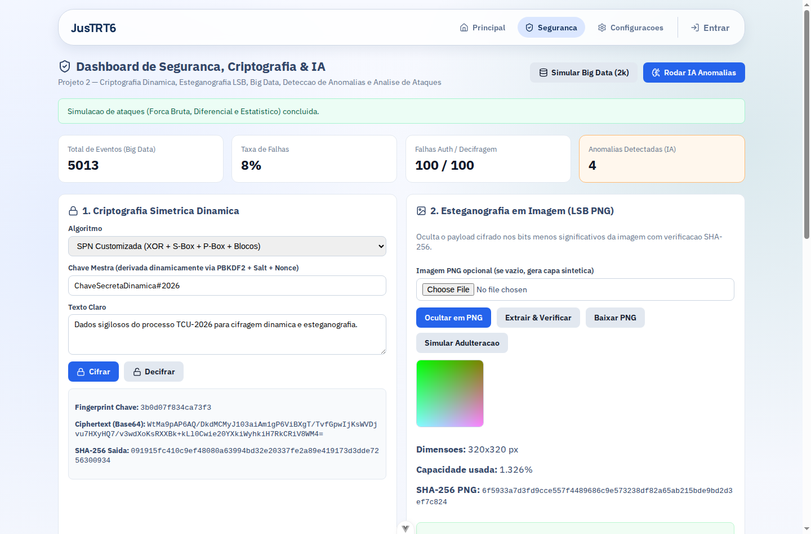
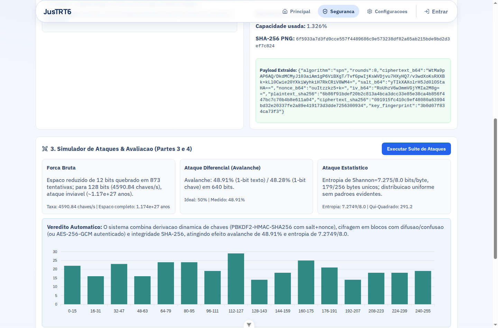
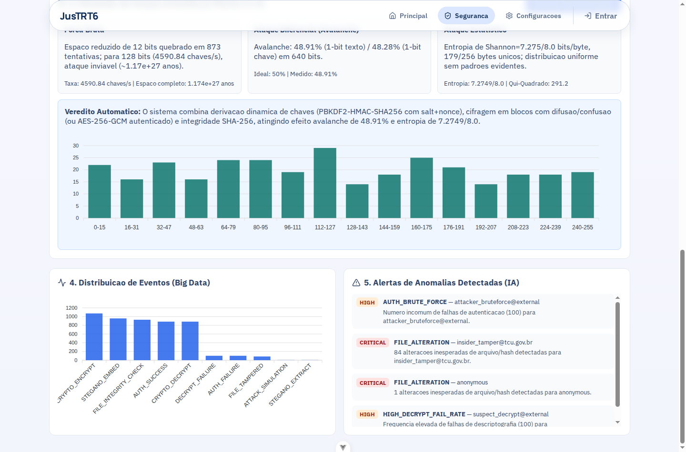

# JusTRT6 / SecureAI Lab — Cibersegurança Aplicada a Dados e IA

> **Disciplina:** Cibersegurança Aplicada a Dados e IA — CESAR School (Prof. Renatta Nigro)  
> **Branch:** `feat/ciberseguranca-parte1-e-2`  
> **Relatório Técnico Completo (PDF):** [docs/Projeto2_Relatorio_Ciberseguranca.pdf](docs/Projeto2_Relatorio_Ciberseguranca.pdf)

Este projeto transforma a plataforma **JusTRT6** em um laboratório funcional de **Cibersegurança, Criptografia, Esteganografia, Big Data e Inteligência Artificial**, permitindo proteger dados sensíveis, ocultá-los em imagens, simular ataques em ambiente controlado e detectar comportamentos anormais em tempo real através de um dashboard interativo.

---

## 1. Visão Geral e Fluxo da Solução

A aplicação segue uma arquitetura em **6 camadas integradas**:

1. **Entrada de Dados:** O usuário informa um texto ou documento sigiloso e uma palavra-chave secreta.
2. **Criptografia Simétrica Dinâmica:** O sistema deriva uma chave única por operação (nunca fixa) e cifra o dado usando a **Cifra em Blocos Customizada (SPN)** ou o padrão de mercado **AES-256-GCM**.
3. **Esteganografia em Imagem (PNG):** O conteúdo já cifrado é escondido dentro dos pixels de uma imagem PNG comum (técnica LSB), acompanhado de uma assinatura de integridade (`SHA-256`).
4. **Big Data (Coleta e Armazenamento de Eventos):** Todas as operações criptográficas, tentativas de login (sucesso e falha), erros de decifragem, violações de arquivo e cargas experimentais são registradas em larga escala no banco de dados e arquivadas no storage.
5. **Inteligência Artificial (Detecção de Anomalias):** Um modelo de aprendizado não supervisionado (`IsolationForest`) analisa o comportamento histórico dos usuários/atores e sinaliza automaticamente atividades suspeitas.
6. **Dashboard de Segurança (`/seguranca`):** Painel visual para operar o fluxo completo, disparar ataques simulados, acompanhar gráficos de distribuição e inspecionar alertas da IA.



---

## 2. O que já existia vs. O que foi construído vs. O que é simulado

Para aproveitar a infraestrutura real do **JusTRT6** sem criar complexidade desnecessária, dividimos a solução entre o que já era nativo da aplicação, o que foi criado para **proteger/detectar de verdade**, e o que é **simulado** para testar a resistência do sistema:

| O que é | Status | Para que serve (`Evitar` / `Detectar` / `Simular`) |
| :--- | :--- | :--- |
| **Sistema de Login, Banco de Dados, Storage de Arquivos (MinIO) e Painel Web** | **Já existia nativamente** | Base real da aplicação sobre a qual a camada de segurança foi acoplada. |
| **Auditoria automática de acessos no Login** | **Construído (Real)** | **Detectar** tentativas reais de invasão registrando cada login bem-sucedido ou falho (com IP e usuário). |
| **Chave Dinâmica + Cifragem (SPN e AES-256-GCM)** | **Construído (Proteção real)** | **Evitar** que dados fiquem legíveis ou que a mesma chave gere sempre a mesma saída. |
| **Esteganografia LSB + Checagem de Integridade (`SHA-256`)** | **Construído (Proteção real)** | **Evitar** que um observador perceba a existência do dado secreto na imagem e **impedir** a leitura caso a imagem tenha sido adulterada. |
| **Simulação de Adulteração (1 byte)** | **Simulado (Ambiente controlado)** | **Testar** na prática a proteção de integridade: alteramos 1 byte da imagem para provar que o sistema rejeita o arquivo e dispara um alerta crítico. |
| **Ataques (Força Bruta, Diferencial e Estatístico)** | **Simulado (Ambiente controlado)** | **Avaliar** se o algoritmo resiste a ataques: medimos velocidade de quebra em espaço reduzido, efeito avalanche e aleatoriedade da saída. |
| **Geração de Carga Big Data (2.000 a 5.000 eventos)** | **Simulado + Dados reais** | **Validar** o processamento de grande volume de logs e fornecer massa suficiente para a IA treinar e identificar padrões fora da curva. |
| **Detecção de Anomalias por IA (`IsolationForest`)** | **Construído (Detecção real)** | **Detectar** automaticamente ataques de força bruta em login, excesso de falhas de decifragem, arquivos adulterados e acessos em horários atípicos. |

---

## 3. Conceitos Importantes para a Apresentação

### Criptografia Dinâmica, Confusão e Difusão
- **Por que a chave não é fixa?** Mesmo que o usuário digite a mesma senha duas vezes, o sistema gera um *salt* e um *nonce* aleatórios a cada operação. Na prática, cifrar a mesma frase duas vezes gera resultados totalmente diferentes — evitando ataques por repetição ou tabelas pré-computadas.
- **Confusão:** Esconde a relação entre a chave secreta e o texto cifrado (feita pela substituição não linear via **S-Box** e mistura **XOR** com subchaves).
- **Difusão:** Faz com que a mudança de **1 único bit** na entrada se espalhe por todo o texto cifrado (feita pela permutação **P-Box**, mistura entre bytes e encadeamento de blocos **CBC**).
- **Por que comparamos SPN Customizada vs. AES-256-GCM?**
  - A **SPN Customizada** (modo CBC) atinge **~50% de efeito avalanche** tanto ao mudar 1 bit do texto (**51,13%**) quanto ao mudar 1 bit da chave (**50,35%**).
  - O **AES-256-GCM** usa internamente modo de fluxo (CTR) + tag de integridade: mudar 1 bit no texto altera apenas o bit correspondente + parte da tag (**4,35%**), enquanto mudar 1 bit na **chave** gera **49,92%** de mudança.

### Criptografia vs. Esteganografia vs. Integridade
- **Criptografia** protege o *conteúdo* (torna ilegível).
- **Esteganografia** protege a *existência* (esconde o conteúdo cifrado dentro dos pixels de uma imagem PNG sem alterar sua aparência visual).
- **Hash SHA-256** garante a *integridade* (se alguém alterar 1 único pixel ou byte da imagem no caminho, o resumo criptográfico não bate e a extração é bloqueada).

### Os 3 Ataques Simulados e o Veredito


1. **Força Bruta:** Testa todas as combinações possíveis em um **espaço reduzido de 12 bits** (quebrado em **873 tentativas**) para medir a velocidade real da máquina (**~2.938 a 4.590 chaves/s**) e comprovar matematicamente que quebrar a chave real de **128 ou 256 bits** levaria $10^{27}$ a $10^{65}$ anos (inviável).
2. **Ataque Diferencial (Efeito Avalanche):** Altera 1 único bit da entrada e compara o antes e depois. Quanto mais próximo de **50%** de bits alterados, melhor a difusão.
3. **Ataque Estatístico:** Verifica se há padrões ou letras repetidas na saída cifrada usando **Entropia de Shannon** (próxima do máximo de **8,0 bits/byte**, atingindo **7,34–7,36**) e distribuição uniforme no gráfico de frequências.

### Big Data e Inteligência Artificial (`IsolationForest`)


- **Por que `IsolationForest`?** É um algoritmo de IA não supervisionado: ele não precisa saber de antemão como será um ataque futuro — ele analisa o comportamento normal da maioria dos usuários e **isola automaticamente quem foge do padrão**.
- **O que a IA observa em cada usuário/ator?** Total de eventos gerados, quantidade de falhas de login, quantidade de falhas de descriptografia, ocorrências de adulteração de arquivo, acessos em horários atípicos (madrugada) e latência média.

---

## 4. Checklist de Requisitos (`Aula 26 - Projeto 2.pdf`)

| Página | Requisito do PDF | Como é cumprido no sistema | Status |
| :---: | :--- | :--- | :---: |
| **Pág. 3 e 7** | Criptografia simétrica com geração dinâmica de chaves (não fixa, influencia a cifragem) | Derivação dinâmica por operação (`PBKDF2-HMAC-SHA256` + salt/nonce aleatórios) em [cipher.py](apps/api/core/security/cipher.py) | ✅ |
| **Pág. 7** | Processo com XOR, Substituição, Permutação, Blocos e Difusão/Confusão | Cifra em blocos de 128 bits (`DynamicSPNCipher`) com 8 rodadas de XOR, S-Box, P-Box e difusão em CBC | ✅ |
| **Pág. 10** | Arquitetura com Criptografia AES-256 (cifragem, chaves e integridade) | Modo `AES-256-GCM` autenticado integrado ao mesmo fluxo em [cipher.py](apps/api/core/security/cipher.py) | ✅ |
| **Pág. 3 e 10** | Esteganografia para ocultação de informações em imagens | Ocultação e extração LSB em imagens PNG com validação `SHA-256` em [steganography.py](apps/api/core/security/steganography.py) | ✅ |
| **Pág. 5** | Big Data: logs criptográficos, acessos, falhas de auth, anomalias e carga experimental | Coleta contínua de eventos reais + gerador de carga em lote (5k+ eventos) e snapshot no MinIO em [anomaly_detector.py](apps/api/core/security/anomaly_detector.py) | ✅ |
| **Pág. 3 e 6** | IA para detectar comportamentos anormais (5 cenários: auth, decifragem, arquivos, acesso, eventos) | Modelo `IsolationForest` classificando e gerando alertas de severidade em [anomaly_detector.py](apps/api/core/security/anomaly_detector.py) | ✅ |
| **Pág. 3, 8 e 9** | Simulação de ataques (Força Bruta, Diferencial, Estatístico) + Avaliação (Parte 4) | Suíte completa com métricas de avalanche, entropia, $\chi^2$, viabilidade e veredito em [attacks.py](apps/api/core/security/attacks.py) | ✅ |
| **Pág. 3 e 10** | Dashboard de segurança para visualizar ataques, anomalias e resultados | Painel interativo em `/seguranca` ([SecurityDashboardPage.vue](frontend/src/pages/SecurityDashboardPage/SecurityDashboardPage.vue)) | ✅ |
| **Pág. 11** | Relatório técnico (Descrição, Funcionamento, Testes, Resultados, Conclusão) | PDF final compilado com métricas reais e imagens em [docs/Projeto2_Relatorio_Ciberseguranca.pdf](docs/Projeto2_Relatorio_Ciberseguranca.pdf) | ✅ |

---

## 5. Roteiro de Demonstração ao Vivo (`/seguranca`)

1. **Provar Chave Dinâmica:** Clique em **Cifrar** duas vezes seguidas com a mesma frase e chave — mostre que o *Fingerprint* e o texto cifrado mudam a cada clique.
2. **Esteganografia & Bloqueio de Adulteração:** Clique em **Ocultar em PNG**, depois em **Extrair & Verificar** (sucesso com `SHA-256` válido) e, em seguida, em **Simular Adulteração** (o sistema bloqueia imediatamente e registra o incidente).
3. **Ataques & Efeito Avalanche:** Clique em **Executar Suite de Ataques** para exibir a quebra em 12 bits vs. inviabilidade em 128/256 bits, o ~50% de avalanche, o gráfico de distribuição de bytes e o veredito automático.
4. **Big Data & IA:** Clique em **Simular Big Data (2k)** e depois em **Rodar IA Anomalias** para atualizar o gráfico de volume de eventos e listar os alertas `HIGH` e `CRITICAL` encontrados pelo `IsolationForest`.

---

## 6. Documentação Complementar e Execução

- **Relatório Final (PDF):** [docs/Projeto2_Relatorio_Ciberseguranca.pdf](docs/Projeto2_Relatorio_Ciberseguranca.pdf)
- **Resultados Experimentais:** [docs/projeto2_relatorio_resultados.md](docs/projeto2_relatorio_resultados.md)
- **Documentação Base (Parte 1):** [PLANO_ADEQUACAO_SEGURANCA.md](PLANO_ADEQUACAO_SEGURANCA.md) e [Relatório Projeto - SecureAI Lab - Cibersegurança.md](Relatório%20Projeto%20-%20SecureAI%20Lab%20-%20Cibersegurança.md)

```bash
# 1. Subir banco, storage e API
docker compose up -d --build postgres minio api

# 2. Subir interface web e acessar /seguranca
cd frontend && npm install && npm run dev -- --port 5173
```
