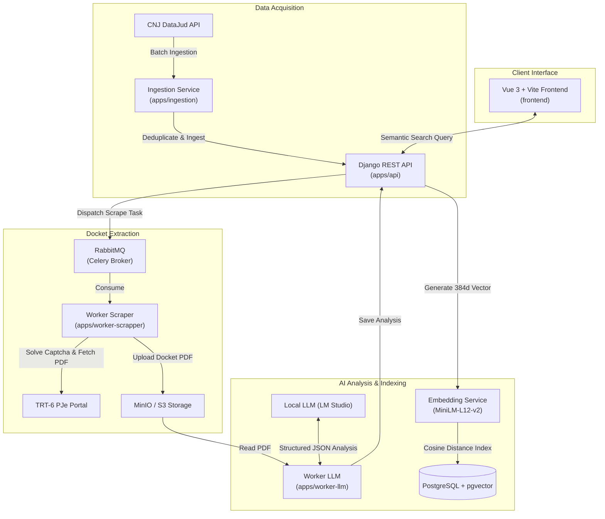

# JusTRT6 — Labor Jurisprudence Intelligence Platform

[](https://www.python.org/)
[](https://www.djangoproject.com/)
[](https://vuejs.org/)
[](https://github.com/pgvector/pgvector)
[](LICENSE)

An end-to-end legal intelligence platform for the **TRT-6** (Tribunal Regional do Trabalho da 6ª Região). It ingests official labor court lawsuits from CNJ DataJud, resolves PJe captchas automatically to fetch full procedural case files, structures rulings and claim outcomes using local LLMs, and powers 384-dimensional vector semantic search with an interactive Vue 3 dashboard.

---

## ⚡ Highlights & Impact

- **End-to-End Automated Pipeline**: Eliminates manual case collection across DataJud and PJe portals.
- **Autonomous PJe Scraping**: Integrated Playwright browser automation coupled with local OCR (`ddddocr`) solves procedural captchas and downloads full PDF dockets without recurring captcha API costs.
- **Structured Legal Extraction**: Local LLM worker (OpenAI-compatible / LM Studio) extracts core judicial acts, outcomes (`ganhou`, `perdeu`, `acordo`), case amounts, court costs, and legal summaries directly conforming to strict Pydantic schemas.
- **Sub-Second Vector Search**: PostgreSQL with `pgvector` and `sentence-transformers` (`paraphrase-multilingual-MiniLM-L12-v2`) performs cosine similarity search across indexed labor precedents.
- **Modern Interactive UI**: High-density Vue 3 + Vite dashboard featuring semantic search, predictive outcome indicators, and case analytics.

---

## 🏗️ System Architecture



---

## 📦 Workspace Structure

The project is managed as a unified [uv](https://github.com/astral-sh/uv) workspace:

```
.
├── apps/
│   ├── api/              # Django 5 + Django REST Framework + pgvector service
│   ├── ingestion/        # DataJud batch ingestion client and normalizer
│   ├── worker-scrapper/  # Playwright + ddddocr scraper for PJe TRT-6
│   └── worker-llm/       # LLM docket parser using OpenDataDataLoader & LangChain
├── frontend/             # Vue 3, Vite, Tailwind/CSS variables, Pinia, Vue Query
├── shared/               # Shared models, S3/MinIO client, Celery client, and embeddings
├── compose.yaml          # Multi-container orchestration (Postgres, RabbitMQ, MinIO, workers)
└── pyproject.toml        # Root uv workspace configuration
```

---

## 🚀 Getting Started

### Prerequisites

- **Python 3.13+**
- **[uv](https://github.com/astral-sh/uv)** package manager
- **[Docker](https://www.docker.com/)** and **Docker Compose**
- **Node.js 20+** or **[Bun](https://bun.sh/)** (for frontend)

### 1. Clone & Environment Configuration

```bash
git clone https://github.com/MigueldsBatista/trt6-juris-intelligence.git
cd trt6-juris-intelligence

# Copy sample environment variables
cp .env.example .env
```

### 2. Launch Infrastructure Services

Start PostgreSQL with pgvector, RabbitMQ, and MinIO:

```bash
docker compose up -d postgres rabbitmq minio
```

Default credentials:
- **PostgreSQL**: `localhost:5432` (db: `trt6`, user: `trt6`, password: `trt6`)
- **RabbitMQ Management**: `http://localhost:15672` (user: `user`, password: `password`)
- **MinIO Console**: `http://localhost:9001` (user: `minioadmin`, password: `minioadmin`)

### 3. Backend & Workspace Setup

Install dependencies across all workspace packages:

```bash
uv sync
```

Apply database migrations:

```bash
cd apps/api
uv run python manage.py migrate
cd ../..
```

Install Playwright browser binaries (for the scraper):

```bash
uv run playwright install chromium
```

### 4. Run the Platform

#### Running via Docker Compose (Recommended)

```bash
docker compose up --build
```

#### Running Locally for Development

In separate terminal sessions:

```bash
# 1. Start Django API
cd apps/api && uv run python manage.py runserver 0.0.0.0:8000

# 2. Start Scraping Worker
uv run celery -A pje_scraper.worker worker --loglevel=INFO

# 3. Start LLM Analysis Worker
cd apps/worker-llm && uv run celery -A worker worker --loglevel=INFO

# 4. Start Frontend
cd frontend && bun install && bun dev
```

---

## 🔌 API Endpoints Reference

Base URL: `http://localhost:8000/api/`

| Method | Endpoint | Description |
|---|---|---|
| `POST` | `/api/processos/deduplicar/` | Ingests and deduplicates processes from DataJud |
| `GET` | `/api/processos/nao_possuem_pdf/` | Lists processes pending docket download |
| `GET` | `/api/processos/nao_possuem_analise/` | Lists processes pending LLM legal analysis |
| `POST` | `/api/processos/adicionar_analise/` | Receives structured LLM output and indexes embeddings |
| `POST` | `/api/processos/busca_semantica/` | 384-dimensional cosine similarity semantic search |
| `GET` | `/health/` | Service health status |

### Semantic Search Example

```bash
curl -X POST http://localhost:8000/api/processos/busca_semantica/ \
  -H "Content-Type: application/json" \
  -d '{
    "consulta": "horas extras não pagas e intervalo intrajornada suprimido",
    "top_k": 5
  }'
```

---

## 🧪 Testing & Code Quality

Run tests across workspaces:

```bash
# Test API
cd apps/api && uv run pytest

# Test scraper worker
cd apps/worker-scrapper && uv run pytest

# Test LLM worker
cd apps/worker-llm && uv run pytest
```

Lint and formatting check:

```bash
uv run ruff check .
```

---

## 📄 License

This project is licensed under the [MIT License](LICENSE).

