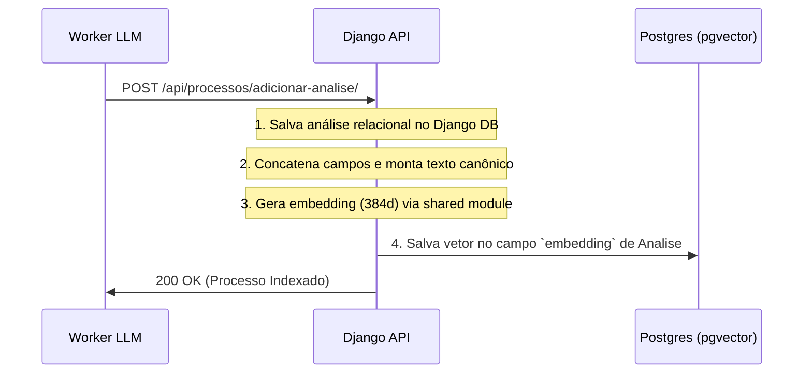

# Especificação Técnica: Busca Vetorial Semântica (PostgreSQL + pgvector)

## Objetivo

Implementar a busca semântica em linguagem natural integrada diretamente ao banco de dados relacional PostgreSQL do monorepo, utilizando a extensão oficial `pgvector` e a biblioteca de integração com o Django ORM.

Esta é a especificação da **implementação concreta** e de produção da funcionalidade, eliminando a necessidade de bancos vetoriais externos.

---

## 🛠️ Requisitos de Infraestrutura & Dependências

### 1. Banco de Dados (PostgreSQL + pgvector)
- **Container Docker**: Substituir a imagem padrão do Postgres no `compose.yaml` pela imagem oficial do pgvector:
  - Imagem: `pgvector/pgvector:pg16` (PostgreSQL 16 com extensão `vector` pré-instalada e compilada).
- **Ativação da Extensão**: A extensão `vector` deve ser ativada na base de dados do Django executando o comando SQL `CREATE EXTENSION IF NOT EXISTS vector;`.
  - No Django, isso é feito de forma limpa através de uma migração contendo a operação `VectorExtension()`.

### 2. Pacotes Python

#### Biblioteca Compartilhada (`shared`)
- **Dependência**: `sentence-transformers>=2.2.0` (para extração local de embeddings).
- **Modelo de Embedding**: `sentence-transformers/paraphrase-multilingual-MiniLM-L12-v2`.
  - Gera vetores densos de **384 dimensões**.
  - Executado localmente em CPU com baixíssima latência.

#### API Django (`apps/api`)
- **Dependência**: `pgvector>=0.2.0` (para suporte a campos vetoriais e operadores de distância no Django ORM).

---

## 🔄 Fluxo de Processamento & Pipeline

A indexação vetorial ocorre de forma **síncrona** na API Django no momento do salvamento da análise de um processo.

### Diagrama de Sequência de Indexação



### 1. Pipeline de Concatenacão (Texto Canônico)
Para maximizar a precisão da busca vetorial, formatamos os campos relacionais e a análise estruturada em um padrão de documento canônico previsível antes de gerar o embedding:

```text
classe: {processo.classe.nome}
orgao_julgador: {processo.orgao_julgador.nome}
assuntos: {assunto_1.nome}; {assunto_2.nome}; ...
resumo: {analise.resumo}
decisao: {analise.decisao}
palavras_chave: {palavra_1}; {palavra_2}; ...
desfecho: {analise.desfecho}
resultado_reclamante: {analise.resultado_reclamante}
```
*Tratamento de vazios:* Valores nulos ou ausentes são formatados como strings vazias para evitar erros ou distorção vetorial.

### 2. Geração e Persistência de Embedding
- O texto estruturado é vetorizado pelo `shared/src/shared/embeddings.py` (Singleton).
- O vetor de 384 floats gerado é armazenado diretamente no campo `embedding` da entidade `Analise`.

### 3. Pipeline de Busca Semântica
Endpoint da API: `POST /api/processos/busca-semantica/`
- Recebe a consulta em formato de texto e realiza a vetorização local na API.
- Executa a busca vetorial por similaridade de cosseno direto no banco de dados:
  ```python
  from pgvector.django import CosineDistance

  # O score de similaridade de cosseno varia entre 0 e 1 (onde 1 é máxima similaridade)
  resultados = Processo.objects.filter(analise__embedding__isnull=False) \
                       .annotate(similaridade=1 - CosineDistance('analise__embedding', query_embedding)) \
                       .order_by('-similaridade')[:top_k]
  ```
- Retorna os dados completos do processo já hidratados do banco com suas respectivas similaridades.

---

## 📝 Definição de Modelos e Endpoints

### 1. Modelo `Analise` (`apps/api/core/models/analise.py`)
```python
from django.db import models
from pgvector.django import VectorField

class Analise(models.Model):
    # ... campos existentes (resumo, decisao, etc.) ...
    embedding = VectorField(dimensions=384, null=True, blank=True)
```

### 2. Endpoint `adicionar_analise`
`POST /api/processos/adicionar-analise/`
Persiste a análise, roda a pipeline de concatenação, gera o embedding e salva de forma síncrona.

### 3. Endpoint `busca_semantica`
`POST /api/processos/busca-semantica/`

**Payload de Entrada**:
```json
{
  "consulta": "horas extras devido a supressão do intervalo para descanso",
  "top_k": 5
}
```

**Payload de Retorno**:
```json
{
  "items": [
    {
      "numero_processo": "0000256-48.2025.5.06.0171",
      "tribunal": "TRT6",
      "classe_nome": "Ação Trabalhista",
      "orgao_julgador_nome": "2ª Vara do Trabalho de Recife",
      "data_ajuizamento": "2025-01-10",
      "resumo": "Processo cobrando horas extras e reflexos...",
      "decisao": "Sentença procedente determinando o pagamento de horas extras...",
      "palavras_chave": ["horas extras", "intervalo intrajornada"],
      "desfecho": "sentenca_procedente",
      "resultado_reclamante": "ganhou",
      "valor_causa": 31399.70,
      "custas_valor_total": 50.00,
      "similaridade": 0.912
    }
  ]
}
```

---

## 🏁 Critérios de Sucesso da Implementação
- O container do PostgreSQL sobe utilizando a imagem `pgvector/pgvector:pg16` com sucesso.
- A migração do Django aplica a extensão `vector` e cria o campo `embedding` na tabela `core_analise`.
- O endpoint `/api/processos/adicionar-analise/` calcula síncronamente e persiste o embedding de 384 floats.
- A busca semântica em `/api/processos/busca-semantica/` retorna resultados ordenados corretamente com scores de similaridade condizentes.
- Todos os testes integrados e unitários passam.
