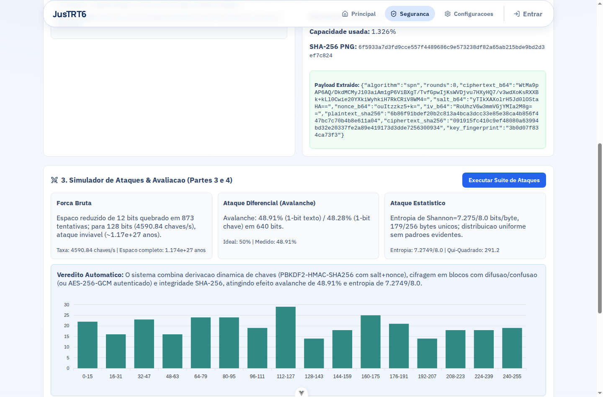
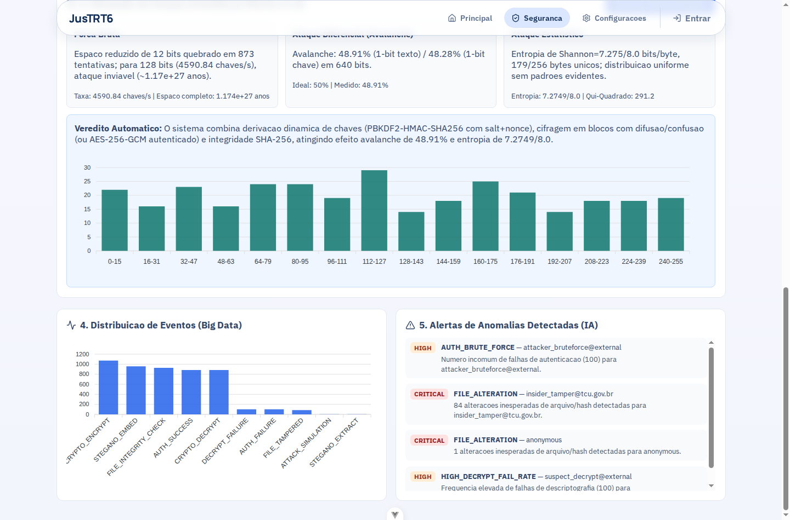

# 1. Descrição do Algoritmo

O sistema desenvolvido no repositório `jurisTCU` implementa uma arquitetura criptográfica híbrida composta por **derivação dinâmica de chaves**, **cifra simétrica em blocos (SPN Customizada)**, **AES-256-GCM** e **esteganografia LSB em imagens PNG**.

## 1.1 Geração Dinâmica de Chaves (`PBKDF2-HMAC-SHA256`)

Para cumprir o requisito de que a chave secreta **nunca pode ser fixa** e deve influenciar todo o processo de cifragem, cada operação gera dinamicamente uma chave de sessão de 256 bits:

- **Salt aleatório:** 16 bytes gerados via `os.urandom(16)` por operação.
- **Nonce aleatório:** 8 bytes gerados via `os.urandom(8)` por operação.
- **Função de derivação:** `PBKDF2-HMAC-SHA256` com `100.000` iterações sobre o segredo fornecido pelo usuário combinado a `salt + nonce`.

Dessa forma, cifrar exatamente o mesmo texto claro com o mesmo segredo produz chaves de sessão e textos cifrados completamente distintos a cada execução.

## 1.2 Cifra Simétrica em Blocos — SPN Customizada (`DynamicSPNCipher`)

Para demonstrar explicitamente os mecanismos de **XOR**, **Substituição**, **Permutação**, **Blocos**, **Confusão** e **Difusão**, foi implementada uma rede de substituição-permutação (*Substitution-Permutation Network — SPN*) operando em blocos de **128 bits (16 bytes)** com **8 rodadas** em modo **CBC** (com Vetor de Inicialização `IV` aleatório de 16 bytes e padding PKCS#7):

1. **Subchaves por rodada:** Derivadas via `HMAC-SHA256(key, "round-{r}")` para cada rodada $r \in [0, 8]$.
2. **XOR (*Key Mixing*):** Combinação bit a bit do estado do bloco com a subchave da rodada.
3. **Substituição (*S-Box*):** S-Box bijetiva de 256 bytes (com inversa pré-computada para decifragem), garantindo **confusão** não linear.
4. **Permutação (*P-Box*):** Reordenação posicional dos 16 bytes do bloco (`(i * 5 + 3) mod 16`).
5. **Difusão Linear (`_diffuse_block`):** Passagem cruzada entre bytes adjacentes com rotação de bits (`(out[nxt] << 1 | out[nxt] >> 7)`), garantindo que a alteração de 1 único bit se propague por todo o bloco.

## 1.3 Cifra de Referência (`AES-256-GCM`) e Esteganografia (`LSB PNG`)

- **AES-256-GCM:** Implementado via biblioteca `cryptography`, utilizando a mesma derivação dinâmica de 256 bits e `nonce` de 12 bytes, fornecendo confidencialidade e tag de autenticação integrada.
- **Esteganografia LSB:** O payload cifrado (em JSON/Base64) recebe um cabeçalho binário estruturado (`JTCU` + tamanho em 4 bytes + digest `SHA-256` em 32 bytes) e é embutido no bit menos significativo (*Least Significant Bit*) dos canais RGB de imagens PNG sem perdas via `Pillow` e `NumPy`. Na extração, o hash `SHA-256` é recalculado para detectar qualquer adulteração de 1 byte.

---

# 2. Funcionamento e Arquitetura

O sistema segue integralmente a arquitetura em **6 camadas** especificada na Parte 5 de `Aula 26 - Projeto 2.pdf`, integrada ao ecossistema já existente do `jurisTCU` (`Django/DRF`, `PostgreSQL`, `MinIO` e `Vue 3`):

| Camada | Componente no `jurisTCU` | Função Principal |
| :--- | :--- | :--- |
| **1. Entrada de Dados** | `/seguranca` + API DRF | Recebe textos, chaves secretas e imagens PNG |
| **2. Criptografia** | `cipher.py` | Derivação dinâmica + SPN (128b) / AES-256-GCM + SHA-256 |
| **3. Esteganografia** | `steganography.py` | Ocultação e extração LSB em PNG com checagem de integridade |
| **4. Big Data** | `SecurityEvent` (PG) + MinIO | Coleta de logs crypto, auth, falhas e carga experimental em lote |
| **5. Inteligência Artificial** | `IsolationForest` (`sklearn`) | Detecção de 5 categorias de anomalias comportamentais |
| **6. Dashboard** | `SecurityDashboardPage` | Visualização de KPIs, gráficos ApexCharts, ataques e alertas |

{ width=95% }

---

# 3. Testes Realizados

Os testes foram executados em dois níveis complementares:

1. **Testes Unitários Automatizados (`pytest`):**
   - Verificação de unicidade da derivação dinâmica de chaves (`derive_dynamic_key`).
   - Ciclo completo de cifragem e decifragem (`spn` e `aes-256-gcm`) e rejeição com chave incorreta.
   - Ocultação e extração LSB em PNG com validação de integridade `SHA-256`.
   - Execução das funções de ataque controlado (`brute_force`, `differential`, `statistical`).
   - Resultado: **5/5 testes aprovados** (`0.83s`).

2. **Experimento Ponta a Ponta contra a API em Containers (`scripts/run_projeto2_experiments.py`):**
   - **Cifragem/Decifragem:** Executada com sucesso em `SPN` (fingerprint `27c61925e7ef919b`) e `AES-256-GCM` (fingerprint `ccb98537b30a87e3`).
   - **Adulteração Controlada:** Alteração de 1 byte na imagem PNG esteganografada gerou rejeição imediata **HTTP 400** (`Steganographic integrity check failed: payload was altered.`) e registro automático do evento `FILE_TAMPERED`.
   - **Big Data & IA:** Ingestão em lote (`bulk_create`) de **5.000 eventos sintéticos** (somando **5.013 eventos totais** no dashboard durante a demonstração interativa) e execução do modelo `IsolationForest` sobre **24 atores**.

---

# 4. Resultados Obtidos

## 4.1 Comparativo de Resistência a Ataques (`SPN Customizada` vs `AES-256-GCM`)

| Métrica Avaliada | SPN Customizada (128 bits) | AES-256-GCM (256 bits) |
| :--- | :---: | :---: |
| **Força Bruta (espaço reduzido 12 bits)** | Quebrado em 873 tentativas | Quebrado em 873 tentativas |
| **Taxa medida (chaves/s)** | 2.938,51 chaves/s | 2.960,19 chaves/s |
| **Tempo estimado (espaço completo)** | $1{,}835 \times 10^{27}$ anos | $6{,}198 \times 10^{65}$ anos |
| **Avalanche (1-bit texto / 1-bit chave)** | **51,13% / 50,35%** | 4,35% / **49,92%** |
| **Entropia de Shannon (máx. 8,0)** | **7,3380** bits/byte | **7,3616** bits/byte |
| **Teste Qui-Quadrado ($\chi^2$)** | 215,11 | 228,65 |

*Observação técnica:* No `AES-256-GCM`, o modo interno CTR atua como cifra de fluxo sobre o texto claro (alterar 1 bit no plaintext altera 1 bit do ciphertext + ~50% da tag GCM, resultando em 4,35%), enquanto a alteração de 1 bit na **chave** atinge **49,92%** de avalanche. Já a `SPN Customizada` em modo CBC atinge ~50% em **ambos** os cenários (**51,13%** no texto e **50,35%** na chave).

{ width=95% }

## 4.2 Big Data e Detecção de Anomalias por IA (`IsolationForest`)

Na base experimental com **5.013 eventos** registrados no PostgreSQL, o modelo `IsolationForest` analisou **24 atores** e identificou **4 anomalias críticas/altas** correspondentes aos cenários da Parte 1:

- `AUTH_BRUTE_FORCE` (**HIGH**): `attacker_bruteforce@external` com 100 falhas de autenticação.
- `FILE_ALTERATION` (**CRITICAL**): `insider_tamper@tcu.gov.br` (84 alterações inesperadas) e `anonymous` (1 adulteração detectada no teste LSB).
- `HIGH_DECRYPT_FAIL_RATE` (**HIGH**): `suspect_decrypt@external` com 100 falhas de descriptografia.

{ width=95% }

---

# 5. Conclusão (Respostas às Questões da Parte 4)

1. **O sistema apresenta efeito avalanche?**
   **Sim.** A cifra `SPN Customizada` apresentou **51,13%** de alteração de bits ao inverter 1 único bit do texto claro (e **50,35%** ao inverter 1 bit da chave), próximo ao ideal teórico de **50%**. O `AES-256-GCM` apresentou **49,92%** na alteração de 1 bit da chave.
2. **Existem padrões na saída?**
   **Não.** A análise estatística revelou entropia de Shannon elevada (**7,3380** na SPN e **7,3616** no AES-256-GCM, em escala de até 8,0 bits/byte para a amostra testada) e distribuição uniforme de bytes no histograma e no teste $\chi^2$.
3. **Qual ataque foi mais eficaz?**
   Apenas o ataque de **força bruta em espaço artificialmente reduzido (12 bits)** obteve êxito (873 tentativas). Contra o espaço completo de 128 bits ou 256 bits, nenhum dos três ataques (força bruta, diferencial ou estatístico) comprometeu o sistema.
4. **O sistema é seguro? Justificativa:**
   **Sim, dentro do escopo projetado.** A combinação de derivação dinâmica de chaves (`PBKDF2-HMAC-SHA256` com `salt` + `nonce`), múltiplas rodadas de confusão e difusão (XOR + S-Box + P-Box em CBC ou `AES-256-GCM`), ocultação LSB protegida por `SHA-256` e monitoramento contínuo por IA (`IsolationForest`) garante confidencialidade, integridade e detecção ativa de comportamentos maliciosos.
